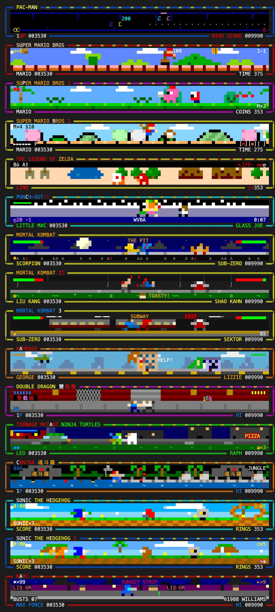

# claude-statusline-arcade-roulette

A Claude Code status line that deals each Claude session one of sixteen classic arcade games. The game comes from a hash of the session ID, so a session keeps its game for its whole life and a new session gets a new roll.

```
CLAUDE v2.5.0                     Opus 5.5 1M context 60% left
╭══ PAC-MAN ═════════════════════════════════════════════════╮
║ ═══════╦══════════════╦═══════════╔═━━═╗═══════════╦══════ ║
║        ╹              ╹200        ║ᗣ  ᗣ║           ╹       ║
║                    ᗣ  ᗤ         · · · · · · · · · · · · ·  ║
║ ═ᗧᗧ═════════╩═════════════════════╩═════════════════════δ═ ║
╰══ 1UP 003530 ═════════════════════════ HIGH SCORE 009990 ══╯
ᗣ 7d 40% ↓3d0h  ᗣ 5h 70% ↓1h30m  xhigh
```

The games: Pac-Man, Super Mario Bros, Super Mario Bros 2, Super Mario Bros 3, The Legend of Zelda, Punch-Out!!, Mortal Kombat, Mortal Kombat II, Mortal Kombat 3, Rampage, Double Dragon, Teenage Mutant Ninja Turtles, Contra, Sonic the Hedgehog, Sonic the Hedgehog 2 and NARC.



## How to read it

The field plays a short scene from the game while Claude works. Pac-Man eats a power pellet and turns on the ghosts, Mario stomps a Goomba and bumps a question block, and two Mortal Kombat fighters trade special moves until one of them hears FINISH HIM!. Each scene is a loop of about a minute, built from the game's best-known moments, and it does not track usage. The animation moves one frame per second while the session works. It stops 30 seconds after the transcript last changed, so the terminal does not show idle tabs as busy.

The header shows the model and how much of the context window is left. The footer shows the remaining percentage and reset countdown for each rate limit, each next to an enemy from the game, plus the `effortLevel` from `~/.claude/settings.json`.

### The screen

Each game draws its own screen in 256 colors, close to the original cabinet or console. The field has four rows:

| Row | Shows |
|---|---|
| Backdrop | the far scenery, such as clouds, a skyline or the Punch-Out!! crowd, and the top of the game's HUD: coins, health bars, the Zelda status bar |
| Sky | the heads and shoulders of the characters, floating blocks, signs and the banner |
| Ground | the rest of the characters and what they stand in front of: hills, pipes, buildings, the ring |
| Base | the floor, such as brick ground, a bridge, acid or the ring apron, and the bottom of the HUD: lives, round clocks, the falcon weapon |

Characters, vehicles and most of the scenery are pixel art. Each cell holds two pixels, one above the other, drawn with half-block characters, so a character two rows tall is four pixels tall. Characters pass in front of the scenery and of each other, and whatever is behind shows through their empty pixels. In a side-scroller, rows further back scroll slower, so the scene has depth. Chinese and Japanese characters, such as the neon 雙截龍 sign in Double Dragon and the 魂斗羅 base wall in Contra, take two columns.

### The animation

- Each beat shows a cause and its effect, a frame at a time: a wind-up, a hit, the reaction and the reward. Points pop up and rise from where they were scored.
- The HUD follows the action, like the lives, coins, health bars and timers around an arcade screen. A health bar drops when a hit lands, a counter goes up when something is collected, and a round clock counts down. The Mortal Kombat games and NARC name the arena or stage in the middle of the top row when the field is wide enough.
- A loop starts again the way the game itself would: after a death, with the next round or the next day, or as the last thing on screen leaves it.
- The title shows the game's own logo colors, with a white glint sweeping across it, and lights chase along the top border.
- Stars twinkle in the empty backdrop of the night scenes.
- While the session is idle, the bottom border of an arcade game shows INSERT COIN. The console games (the three Super Mario Bros games, Zelda, Punch-Out!! and the two Sonic games) had no coin slot, so they show PAUSE, and Zelda shows its CONTINUE · SAVE · RETRY menu.

### What each game shows

| Game | Scene and loop |
|---|---|
| Pac-Man | the maze, with the ghost house and its pink door hanging from the top wall. READY!, a chase down a corridor of pellets that vanish as Pac-Man eats them, the power pellet, both ghosts eaten for 200 and 400 while the second flashes white, their eyes flying home over the door, and the bonus fruit and its score. Then a ghost drops down in front of him, and he spins away before the next READY! |
| Super Mario Bros | World 1-1 scrolling past, with clouds, hills, bushes and pipes over the brick ground. Mario stomps a Goomba flat for 100, hops into a question block for a coin and 200, then stomps a Koopa and kicks its shell away. In the castle he jumps Bowser's fire on the bridge, Bowser drops into the lava, and THANK YOU MARIO! appears |
| Super Mario Bros 2 | Subcon's grassland, with striped hills, palms and vegetable tufts. The hero pulls a turnip and throws it at a Shy Guy, collects five cherries for a Starman, takes one of Birdo's eggs and loses a segment of the life meter, throws a POW block that flashes the screen and drops every enemy, and jumps for a heart that refills the meter |
| Super Mario Bros 3 | Grass Land, with outlined striped hills and giant bolted blocks over the black stage band that holds the HUD. Raccoon Mario fills the P-meter and takes off, grabs coins in the air, stomps a Goomba and a Koopa and kicks the shell into the next enemy for 400. Then he jumps into the goal roulette: COURSE CLEAR!, YOU GOT A CARD, and the card joins the HUD in its own color |
| The Legend of Zelda | the black status bar with the items and the hearts, over the overworld seen from above: cliffs, trees, Armos statues and a lake. An Octorok's rock costs Link a heart, which turns into an empty container. He stabs the Octorok, picks up the heart it drops, and at full health his sword flies as a beam into the next monster, which drops a rupee. The old man's cave, Death Mountain with its boulders, the graveyard and the nine dungeons each have their own scene; in a dungeon, Link takes a key, beats the level's boss and holds up the Triforce piece |
| Punch-Out!! | the ring from the side, under a dark crowd full of camera flashes. Little Mac jabs into a block and loses a heart, ducks the opponent's big punch after his tell, counters for a star, and leaps into a star uppercut as every camera flashes. The opponent goes down, Mario counts 1, 2, 3, Doc Louis shouts a tip, and the boxer gets up for FIGHT! |
| Mortal Kombat | one round in the Pit (a stone bridge over spikes under the moon), the Courtyard or Goro's Lair, with Goro or Shang Tsung watching. FIGHT!, an exchange with blood and draining health bars, both fighters' special moves (Scorpion's spear, Sub-Zero's freeze, Liu Kang's fireball, Raiden's lightning), an uppercut that sends the rival flying, FINISH HIM! while it staggers, then the arena goes dark for the fatality and the hero wins |
| Mortal Kombat II | the same round in the Dead Pool (hooks over bubbling acid), the Living Forest, the Portal or the Kombat Tomb, with Shao Kahn or Kintaro watching. Dan Forden's face comes up with TOASTY! at the uppercut, and the finisher is a FATALITY, a FRIENDSHIP or a BABALITY |
| Mortal Kombat 3 | the same round in the Subway (a train rushes past just after FIGHT!), the Street, the Pit 3 or the Graveyard, with Shao Kahn or Motaro watching and a round clock counting down from 99. Sub-Zero's ice and Cyrax's net hold the rival in place, and the finisher is a FATALITY, an ANIMALITY or a BABALITY |
| Rampage | a city block by day or by night, with a tan tower and the rival's tower beside it. The monster climbs and punches holes in the tower, eats the person screaming HELP! in a window for 200, swats the helicopter that shoots it for 500, and jumps down as the tower sinks into a dust cloud and leaves rubble for 1000. The next day starts with a new tower |
| Double Dragon | a dark red brick wall with the neon 雙截龍 sign, a chain-link fence and a gray sidewalk, the factory with its conveyor belt, or the forest. Billy jabs a gang member with hit sparks and kicks him down for 100, picks up the weapon he drops and uses it for 200, and knocks him out with a flying jump kick for 300. Then the boss walks past behind him with Marian over his shoulder |
| Teenage Mutant Ninja Turtles | a night street with a burning building, April waving from a window, a PIZZA sign and the Party Wagon. The turtle sends a Foot Soldier spinning into the sky, takes a kick from one that leaps out of a manhole, beats the boss as both health bars drain, and eats the pizza it drops to refill his own |
| Contra | the stage 1 jungle at night, with palms, a sniper tower and the Red Falcon base wall with its 魂斗羅 sign, over a bridge that is always blown up behind the player. Bill shoots a soldier, bursts a falcon capsule open for the session's weapon and fires its own shots, then trades shots with a sniper and falls into the river before he respawns. The alien lair (心臓) has flesh walls, buggers and an egg pod |
| Sonic the Hedgehog | Green Hill scrolling fast over checkered soil, with clouds, palms and the sea behind. The title card shows while Sonic collects rings. He spin-jumps onto a Motobug that frees an animal, rolls into an item monitor for ten rings, runs the loop, smashes a Buzz Bomber, loses his rings on the spikes and grabs two back, and passes the spinning goal sign. Marble Zone runs over lava, Star Light Zone is at night, and act 3 brings Robotnik and his wrecking ball |
| Sonic the Hedgehog 2 | Emerald Hill, with waterfalls and sunflowers. Tails follows Sonic through a row of rings, both spin-dash through a Badnik that frees an animal, they bounce on a monitor, jump a Buzzer's shot and smash it, and a star post adds a Chaos Emerald before the goal sign. Chemical Plant runs over the Mega Mack, Casino Night has bumpers and a slot machine that pays out rings, and act 2 brings Robotnik's drill car |
| NARC | a night street with a skyline, a flickering LIQUOR sign and street lamps. Max Force blows a charging thug apart with his gun or a rocket and grabs the cash for 500, then busts a dealer who drops his stash while the sky strobes red and blue, and the red Narc car takes the dealer away. The Bridge has cables, traffic and the river, and in Mr. Big's lab Mr. Big laughs at Max and runs off |

### Per-session variety

Each session also gets its own version of its game, picked from a hash of the session ID. A session keeps the same picks for its whole life, and a new session rolls new ones.

| Game | What varies |
|---|---|
| Pac-Man | which two ghosts chase while the other two wait in the house, the fruit and its score, the spare lives and the opening banner (READY!, PLAYER ONE, or READY! with GAME OVER after the death) |
| Super Mario Bros | Mario or Luigi, the world and level (level 2 is underground, level 3 is the treetops, level 4 is the castle with Bowser), the coin count and the lives |
| Super Mario Bros 2 | Mario, Luigi, Toad or Peach, the world and level (worlds 2 and 6 are desert, 4 is ice), the enemy the Starman knocks over, the Shy Guys' robe and the lives |
| Super Mario Bros 3 | Mario or Luigi, the suit (Super, Fire, Raccoon, Tanooki, Frog or Hammer, which fly, jump or throw), Grass Land, Desert Land under the Angry Sun or the airship with a Koopaling, the first enemy, the enemy the shell hits, the cards, the coins and the lives |
| The Legend of Zelda | the place (the overworld, the old man's cave, Death Mountain, the graveyard or one of the nine dungeons with its own colors, guard and boss), the tunic, the sword, the B item, the heart containers, the overworld monsters, the cave dweller and gift, and the keys |
| Punch-Out!! | the opponent from the circuit in his own colors (King Hippo is wider and wears a crown), the next contender, the stars and hearts, Doc Louis's tip and the round clock |
| Mortal Kombat, II and 3 | your fighter and the rival from that game's roster, with their colors, special moves and finishers, the arena, the boss watching, the round, a flawless round in some sessions, and in II and 3 the finisher |
| Rampage | your monster and the rival, the day's city, day or night, and the food in the window |
| Double Dragon | Billy (1P, blue) or Jimmy (2P, red), the mission, the gang member, the boss carrying Marian, the weapon and the spare lives |
| Teenage Mutant Ninja Turtles | your turtle in its mask color with its own weapon, the partner turtle, the boss, the Foot Soldiers' uniform, the banner, the lives and the pizza count |
| Contra | Bill (1P, blue) or Lance (2P, red), the weapon (S, M, L, F or R) with its own shots, the stage (the jungle or the alien lair), the spare medals and the banner |
| Sonic the Hedgehog | the zone (Green Hill, Marble or Star Light), the act (act 3 brings Robotnik), the Badniks, the clock and the lives |
| Sonic the Hedgehog 2 | Sonic and Tails, Sonic alone, Tails alone or Super Sonic, the zone (Emerald Hill, Chemical Plant or Casino Night), the act (act 2 brings Robotnik), the Badniks, the Chaos Emeralds, the clock and the lives |
| NARC | Max Force (1P, blue) or Hit Man (2P, red), the gun or the rockets, the thug, the stage (Sunset Strip, the Bridge or Mr. Big's lab), the opening banner, the ammo, the rockets and the busts |

### The scoreboard

The bottom border shows a scoreboard in the style of each game. The score is 10 points for each line Claude added or removed in the session. Super Mario Bros 2 and Zelda keep no score, so they count lines instead, as coins and rupees. The arcade games show a high score, which is the best score for that game across all sessions. It is kept in `~/.claude/arcade-roulette-scores.json`, which the status line writes only when a session beats it.

| Game | Left | Right |
|---|---|---|
| Pac-Man | `1UP` and the score (1UP blinks) | `HIGH SCORE` |
| Super Mario Bros | `MARIO` or `LUIGI` | `TIME`, which starts at 400 and loses one per minute of the session |
| Super Mario Bros 2 | the hero's name | `COINS` and one coin per line changed |
| Super Mario Bros 3 | `MARIO` or `LUIGI` | `TIME`, which starts at 300 and loses one per minute of the session |
| The Legend of Zelda | `LINK` | `◊×` and one rupee per line changed |
| Punch-Out!! | `LITTLE MAC` and the points | the opponent's name |
| Mortal Kombat, II and 3 | your fighter's name | the rival's name |
| Rampage | your monster's name | the rival monster's name |
| Double Dragon | `1P` or `2P` | `HI` |
| Teenage Mutant Ninja Turtles | your turtle's name | the partner turtle's name |
| Contra | `1P` or `2P` | `HI` |
| Sonic the Hedgehog and 2 | `SCORE` | `RINGS` and one ring per line changed |
| NARC | `MAX FORCE` or `HIT MAN` | `HI` |

When the border is too narrow for both sides, the right side goes first.

## Install

Requires Node 18.3 or later and a terminal with 256-color support. No dependencies.

```sh
git clone https://github.com/alanmarcero/claude-statusline-arcade-roulette.git ~/Development/claude-statusline-arcade-roulette
```

Add it to `~/.claude/settings.json`:

```json
"statusLine": {
  "type": "command",
  "command": "node ~/Development/claude-statusline-arcade-roulette/arcade-roulette.js",
  "refreshInterval": 1
}
```

`refreshInterval` makes Claude Code run the status line every second. Without it, the status line only redraws when the session changes, so the animation stops while the session is idle.

## Options

- `--game <id>` locks one game: `pacman`, `mario`, `mario-2`, `mario-3`, `zelda`, `punch-out`, `mortal-kombat`, `mortal-kombat-2`, `mortal-kombat-3`, `rampage`, `double-dragon`, `tmnt`, `contra`, `sonic`, `sonic-2` or `narc`.
- `--width <n>` sets the width. The default is the terminal width minus 20 columns for the Claude Code buddy, clamped to 30 to 90.

To preview every game:

```sh
for game in pacman mario mario-2 mario-3 zelda punch-out mortal-kombat mortal-kombat-2 mortal-kombat-3 rampage double-dragon tmnt contra sonic sonic-2 narc; do
  echo '{"context_window":{"used_percentage":40},"rate_limits":{"five_hour":{"used_percentage":30},"seven_day":{"used_percentage":60}}}' \
    | node arcade-roulette.js --game "$game"
done
```

## Credit

Based on [sorosora/arcade-statusline](https://github.com/sorosora/arcade-statusline), which has the original Pac-Man and Pikmin themes.
